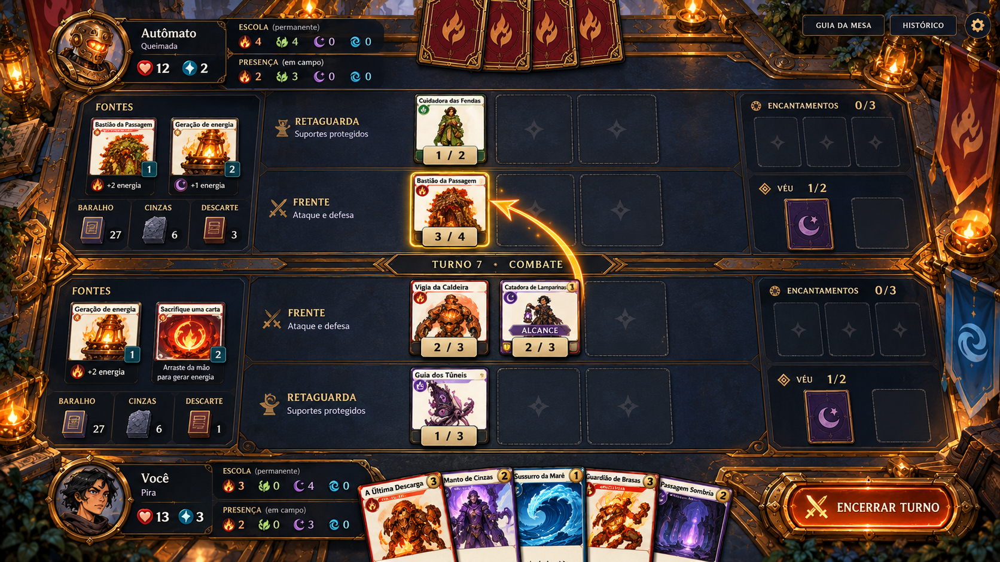
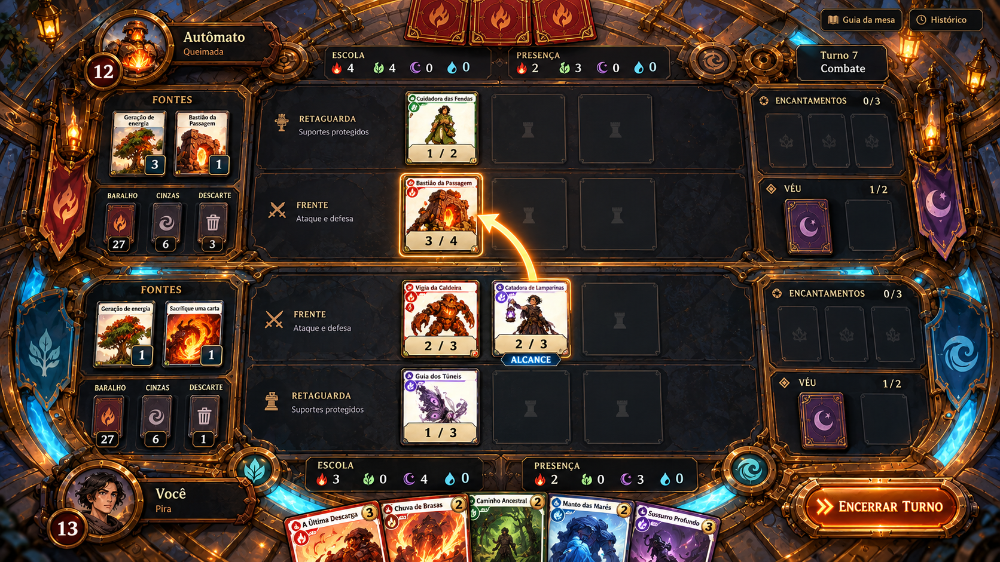
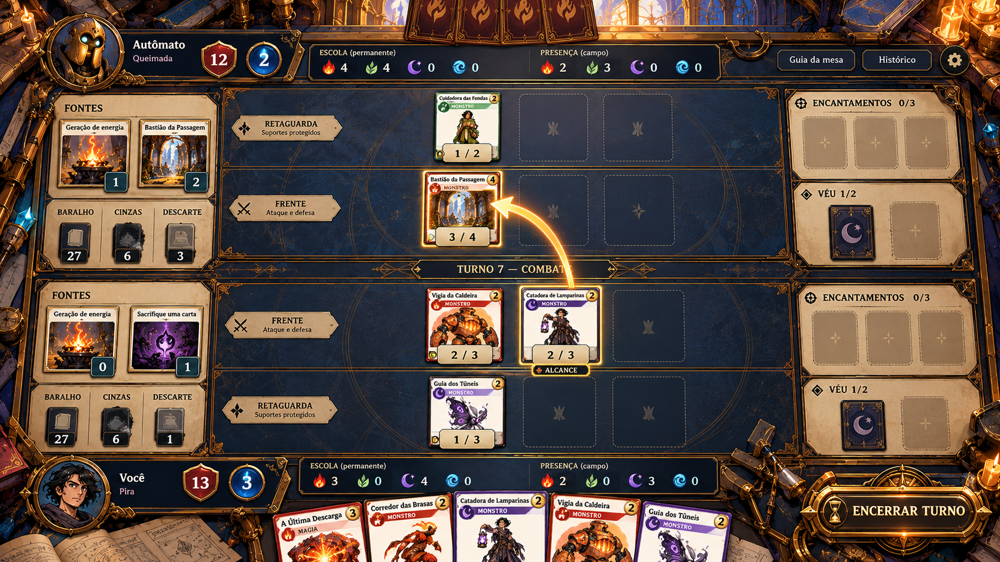

# Mesa de batalha — três direções dentro do Santuário

23/10/2026 · WB-D16 · **Estudo histórico: C escolhida posteriormente em WB-D17.** A recomendação A abaixo registra o parecer anterior à escolha humana. Implementação Atlas em [WB-006](../../specs/WB-006-atlas-do-conclave.md); aprovação da direção não equivale a aceite do layout implementado.

Pedido: enquanto testa a 0.5.0, o usuário quer direções de arte para elevar a batalha ao padrão do Santuário do Pulso. A home A continua escolhida; esta comparação trata do espaço de duelo, composição e HUD. Não redefine as cartas Bestiário em Foco.

## Referências e evidência

- [Home aprovada](home-a-santuario-do-pulso/conceito-v1.png): bronze/latão trabalhado, pedra azul, núcleo âmbar e canais turquesa; massa de arquitetura nas bordas, destinos físicos. Referência autoral do próprio projeto, não uma imagem de jogo externo.
- [Captura real anterior do usuário](../../qa/referencia-previa-usuario-v021.png): quatro fileiras, fontes à esquerda, rituais à direita e mão embaixo. O painel lateral fixo mostrado nessa captura já foi rejeitado/corrigido; não é referência de comportamento desejado. Os números e a regra de recursos dessa captura também são antigos.
- Frentes de referência [Vigia](../../src/public/cartas/VES-002.png) e [Catadora](../../src/public/cartas/VES-047.png): papel claro, molduras por escola, figura em foco e ícones aprovados. **Não usar faces redesenhadas pela IA em produção.** As pranchas estudam a composição, sem garantir fidelidade de cada letra/símbolo ou quantidade gerada.
- [Padrão do catálogo: composição em camadas](../../../../catalogo/padroes/composicao-cenario-em-camadas.md): aproveitar hierarquia por planos e reduzir ruído nas áreas de ação. Não incorporar assets da referência nem transferir automaticamente estética/custos.

Inferência visual: a mesa atual reserva muita superfície aos painéis e rótulos, enquanto o santuário oferece riqueza de materiais. A oportunidade é concentrar acabamento nas bordas e levar cartas/ações para um centro maior e calmo. Não há medição nova de fluidez ou aprovação humana desse diagnóstico nesta rodada.

## Situação comum do briefing

Cena de composição fictícia, **não snapshot extraído da partida do usuário**: turno 7, Combate, Você/Pira Vida 13/Energia 3 contra Autômato/Queimada Vida 12/Energia 2. Três posições por fileira; oponente tem Cuidadora atrás e Bastião à frente, aliado tem Vigia/Catadora à frente e Guia atrás. Duas fontes por lado, encantamentos vazios, um Prenúncio oculto por lado. Mão própria cinco cartas em gaveta, rival quatro versos. Flecha de Catadora até Bastião; carta atacante permanece no lugar. Catadora tem Alcance do Guia.

Escola e Presença em grupos distintos, por jogador. Briefing: próprio Escola Chama 3/Sombra 4, Presença Chama 2/Sombra 3; rival Escola Chama 4/Raiz 4, Presença Chama 2/Raiz 3; demais escolas zero. Isso pressupõe fontes Chama/Sombra próprias e Chama/Raiz rivais. A imagem pode conter diferenças de geração; o motor real continua a única autoridade. A cena serve para comparar linguagem e ocupação de espaço.

## A — Mesa do Pulso

**Tese:** duelo físico dentro da oficina sagrada. Uma mesa retangular de pedra/couro azul, bordas de latão e trilhos discretos. O santuário aparece em colunas/lamparinas periféricas, sem uma pintura concorrendo com as cartas.

- **Composição:** câmera quase de cima, perspectiva restrita à borda. Quatro fileiras retas no centro, fontes em encaixes de fornalha à esquerda, rituais em bandejas à direita. Mão nasce do rebordo inferior. Cartas frontais e sem distorção de perspectiva.
- **Personagens:** somente figuras das cartas e pequenos medalhões dos magos; sem personagens gigantes obstruindo zonas. Ilustrações preservadas, estados dinâmicos em etiquetas independentes.
- **Cor/material:** couro e pedra `#17252D`, latão `#B78A49`, papel `#F1E3C6`; âmbar para interação e turquesa contido para energia. Dano coral e cura verde-claro, com número/sinal redundantes.
- **HUD/tipo:** títulos serifados curtos nas placas; textos e números em sans-serif. Escola como registro permanente gravado, Presença como linha de estado atual. Energia em reservatório separado, Vida no medalhão. Slots vazios discretos; rótulo e capacidade permanecem visíveis.
- **Movimento/VFX:** fonte acende seu encaixe ao gerar; ganho de Escola ilumina um traço no registro, Presença atualiza o número junto ao campo. Flecha fina com alvo contornado; impacto localizado e breve, sem sacudir toda a mesa. Reduzir movimento quando solicitado.
- **Custo/risco:** médio. Fundo em planos, guarnições e componentes de UI reaproveitáveis. Cuidado para não cercar cada controle de ouro ou recriar seis painéis enormes. Melhor continuidade com a home e sensação de cartas físicas.
- [Prompt completo](batalha-a-mesa-do-pulso/prompt.md).

## B — Arena do Coração

**Tese:** o duelo acontece num círculo ritual mecânico. O tabuleiro tem profundidade de arquitetura; a organização das cartas permanece reta e clara.

- **Composição:** mesma câmera quase superior e mesmas quatro fileiras; anéis quebrados e nichos ao redor da área de jogo. Medalhões nos polos superior/inferior. Fontes em alcovas e Véu em nichos rituais. Os anéis não alteram vagas ou regras.
- **Personagens/cenário:** altar e vestígios do coração fora da grade central; magos em retratos pequenos. Cartas continuam objetos planos; nenhuma conversão automática em criaturas 3D.
- **Cor/material:** obsidiana azul `#12232D`, bronze `#A9783B`, turquesa `#57B5BD` nos canais, luz âmbar `#EFAB51` no núcleo. Centro de baixo contraste para preservar o papel claro das cartas.
- **HUD/tipo:** Vida encaixada nos dois polos do círculo, Escola/Presença em trilhos separados ligados ao retrato. Labels serifados de pedra, corpo sans-serif; escola e energia nunca dependem só de luz/colorização.
- **Movimento/VFX:** fluxos periféricos sincronizados com turno/geração, runa breve no destino da conjuração, impacto que interrompe o canal local. Flecha de ataque sempre mais contrastante que a iluminação do cenário. Sem pulsação contínua em todos os slots.
- **Custo/risco:** alto. Exige recorte de camadas, adaptação dos anéis a proporções diferentes e orçamento de VFX. Maior espetáculo, mas pode fazer as cartas parecerem pequenas e atrapalhar destinos de drag. Cenário deve ceder espaço ao campo, não o contrário.
- [Prompt completo](batalha-b-arena-do-coracao/prompt.md).

## C — Atlas do Conclave

**Tese:** uma mesa estratégica de arquivo, precisa e silenciosa, com acabamento de santuário. Prioriza informação e espaço das cartas.

- **Composição:** superfície ampla de ardósia azul, divisórias finas de latão e abas de papel. Cenário ilustrado restrito aos cantos e topo; quatro fileiras sem perspectiva. Fontes como pequeno arquivo lateral, rituais como inserções do atlas. Mão numa gaveta rasa.
- **Personagens/cenário:** retratos reduzidos, ferramentas de cartografia/arquivo apenas nas bordas. Arte das criaturas permanece nas cartas. Reflexos/ornamentos sugerem a catedral sem pintar uma paisagem sob os textos.
- **Cor/material:** ardósia `#18262C`, pergaminho `#E8D9BA`, ouro envelhecido `#B69B64`; turquesa reservado a recursos e âmbar a ações. Menor saturação ambiental que A/B.
- **HUD/tipo:** faixas compactas e alinhadas; Escola em registro numerado e Presença imediatamente abaixo como estado atual. Placas planas com forte hierarquia tipográfica. Capacidade/contador em texto; ícones não substituem o nome da zona.
- **Movimento/VFX:** carta eleva levemente no hover, alvo recebe contorno contínuo, seta desenha o caminho; alterações numéricas discretas. Histórico/gatilhos podem usar lâminas de pergaminho sobre a borda. Sem hologramas ou grade sci-fi.
- **Custo/risco:** médio-baixo relativo às demais. Facilita escala/responsividade e leitura competitiva. Pode parecer menos espetacular; preservar textura e objetos nas bordas para não voltar à aparência de dashboard.
- [Prompt completo](batalha-c-atlas-do-conclave/prompt.md).

## Contrato comum para a implementação escolhida

1. **Hierarquia:** cartas → decisão/alvo → recursos → cenário. Jogável sem rolagem de página nos alvos desktop. Priorizar centro em vez de grandes cabeçalhos e painéis vazios.
2. **Vagas:** três monstros por fileira, três encantamentos e dois Prenúncios; slots e disposição não mudam regras. Fontes não são um número novo de vagas fixas. Baralho/Cinzas/Descarte consultáveis respeitam privacidade do motor.
3. **Escala proposta, não medida:** testar cartas próximas a 120×168 px em 1920×1080 e 90×126 em 1366×768, reservando espaço para quatro ranks, HUD e mão recolhida. Essas dimensões são alvos iniciais, não compromisso de legibilidade dos textos impressos em miniatura.
4. **Leitura:** inspeção grande flutuante acompanha mouse, sem painel fixo lateral ou interceptar drag. Nome, poder/vida e badges nomeados continuam acessíveis. Texto de regra integral pertence à inspeção; não encolher tudo para caber em miniaturas.
5. **Input:** ataque usa apenas flecha, mantém a carta na origem e o alvo visível. Sacrifício/conjuração têm destinos claros e retorno em soltura inválida. Foco por teclado, Esc e escolha humana de alvo/gatilho preservados.
6. **Recursos:** Escola permanente e Presença atual são grupos rotulados, não dois números indistinguíveis ao lado do mesmo símbolo. Explicar a diferença na consulta; não usar barras que sugiram consumo de Escola.
7. **Escolhas/gatilhos:** painel temporário de decisão com o mesmo metal/papel e texto legível; não cobrir as duas fileiras envolvidas. Mostrar fonte/efeito e prioridade escolhida. Não simular execução automática que substitua a decisão humana.
8. **Arte modular:** cenário e ornamentação raster próprios, controles/texto/ícones vetoriais ou HTML separados. Não implementar a batalha como screenshot único com alvos invisíveis, nem importar redesenhos gerados das frentes aprovadas. Preservar os PNGs e símbolos canônicos.
9. **QA após implementação:** capturas e movimento em 1366×768, 1920×900 e 1920×1080, todas as vagas ocupadas, mão 8, fontes numerosas, hover nas bordas, ataque a fonte/monstro/mago, escolas altas, dano e gatilhos simultâneos. Medir fluidez/custo em execução; conceito estático não prova performance.

## Comparação e recomendação

Revisão das imagens geradas: A conserva bem o contraste entre mesa azul e bronze, mas ainda reserva muita largura aos nomes das fileiras; B apresenta aros e canais periféricos mais chamativos e precisa reduzir essa competição; C separa melhor o papel dos painéis laterais da ardósia central, mas ainda exige ampliar as cartas e comprimir cabeçalhos. Nos três, o espaço do campo deve ser refinado em UI real após a escolha.

**Limites observados da geração:** aparecem cartas/fontes fictícias com rótulos como “Geração de energia”, personagens/ícones alterados e pequenas divergências de valores/versos. Em B a energia não fica tão explicitamente identificada quanto no briefing; C mostra um marcador de fonte zero que não representa uma fonte ativa válida. Esses detalhes não são propostas de regra, novos assets aprovados ou comportamento a implementar. As três imagens são pranchas de composição, não uma prova de estado legal do motor. Corrigir esses elementos com dados e frentes originais na produção, sem reproduzir as distorções das pranchas.

| Critério | A — Mesa | B — Arena | C — Atlas |
| --- | --- | --- | --- |
| Sensação principal | cartas físicas e ofício | ritual e confronto | estratégia e leitura |
| Continuidade com home A | mais direta | arquitetônica/épica | materiais/editorial |
| Espaço de informação | bom, com bordas contidas | mais sensível ao cenário | mais favorável |
| Produção relativa | média | alta | média-baixa |
| Risco principal | molduras pesadas | brilho/profundidade competirem | perder presença de mundo |

**Recomendação do agente: A — Mesa do Pulso**, com a disciplina de leitura de C na execução. Não combinar automaticamente nem registrar como escolha aceita. O usuário pode escolher A/B/C ou pedir uma combinação. As imagens são propostas ilustradas, não capturas de uma nova batalha implementada; a partida 0.5.0 permanece intacta enquanto ele testa.
