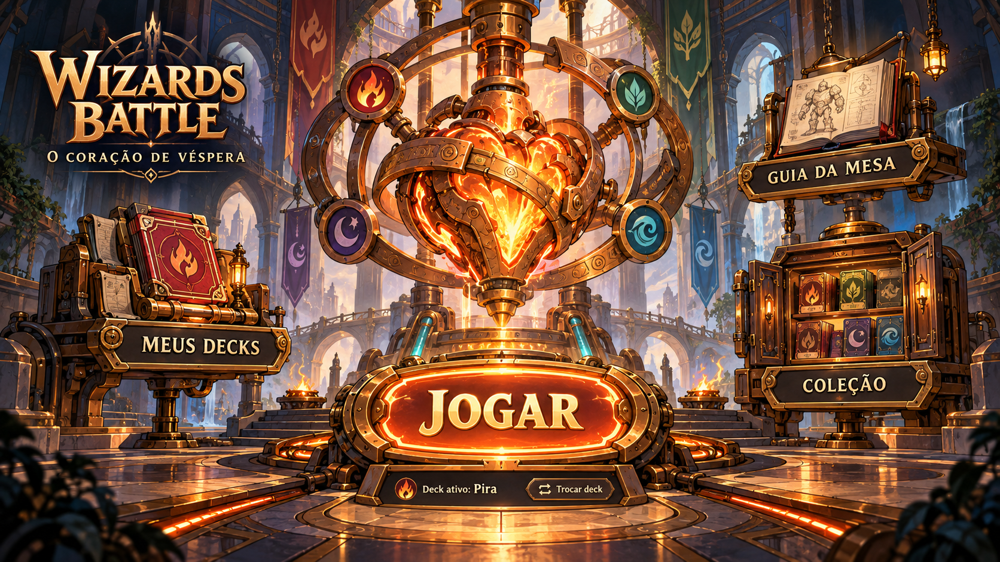
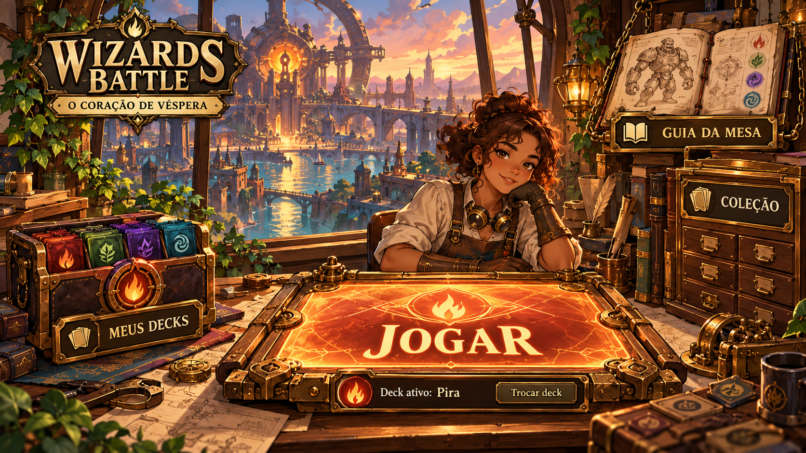
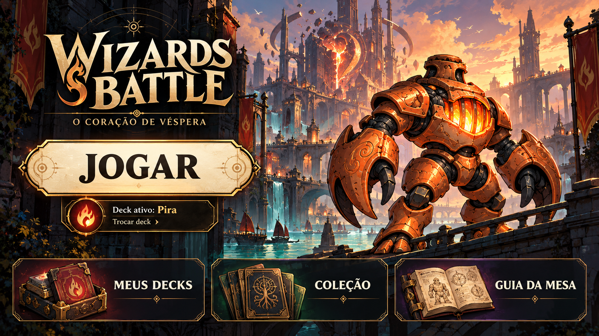

# Tela inicial — três propostas para escolha

23/10/2026 · WB-D13 · estudo histórico. **Escolha posterior: A, confirmada em WB-D14 e implementada na 0.5.0.** As alternativas e recomendações abaixo registram a etapa anterior à escolha.

Usuário rejeitou a tela inicial 0.4.0 com duas barras de rolagem e pediu pesquisa de telas de jogos e propostas, possivelmente um hub. As cartas continuam na direção aprovada **Bestiário em Foco**. Esta revisão trata do cliente/entrada, não das molduras das cartas.

[Galeria local](http://127.0.0.1:4180/estudos/home-presenca.html). Ilustrações conceituais geradas com imagegen a partir de referência da carta VES-002; não são capturas do jogo implementado. Prompts completos nos diretórios abaixo. Menus desenhados, logotipo e símbolos gerados são estudos de composição; a implementação usará texto acessível e iconografia aprovada, não recortes dos textos rasterizados.

## Pesquisa e princípios

- [MTG Arena — State of the Game: Alchemy, 2021](https://magic.wizards.com/en/news/mtg-arena/mtg-arena-state-game-alchemy-2021-12-02): discussão oficial da revisão do Play Blade e de seleção difícil de interpretar. Aplicação proposta: primeiro escolher a atividade; configurar o duelo só depois.
- [Riot — World Adventures, The Path of Champions](https://support.riotgames.com/en-us/legends-of-runeterra/gameplay/world-adventures-the-path-of-champions/): navegação por nós regionais e consulta ao diário. Referência de hub de um modo, sem alegar que esta seja a home atual de LoR. Aplicação: destinos espaciais com rótulos claros e equivalência por teclado.
- [Hearthstone, registro visual histórico de 2015](https://www.digitalspy.com/videogames/a652257/hearthstone-reveals-its-new-tavern-brawl-mode-and-card-back-collection-manager/): menu como objeto físico, ações centrais e coleção abaixo. Referência histórica de organização, sem copiar madeira, símbolos ou assets e sem tratar a captura como interface atual.

Inferência de design: a home deve ter apenas Jogar, Meus decks, Coleção e Guia da mesa. Deck ativo aparece de forma compacta. Após Jogar, um painel separado escolhe deck, rival e variante; detalhes avançados recolhidos. A longa configuração deixa de disputar espaço com a apresentação do jogo. Sem inventar loja, moedas, missões ou ranques.

## A — Santuário do Pulso · recomendação

- **Composição/UI:** coração mecânico central, Jogar à frente; caixa de decks à esquerda, coleção à direita e guia acima. Placa pequena de deck ativo. Zonas clicáveis reais acompanham os rótulos, com foco e alternativa linear por teclado.
- **Mundo/personagens:** arquitetura de uma casa de máquinas quase sagrada; coração e tubulações contam o conflito de Véspera sem depender de um novo protagonista. Guardiões podem aparecer como silhuetas discretas, sem competir com os destinos.
- **Paleta/tipo:** pedra azul-escura, latão, papel marfim, núcleo laranja e canais turquesa. Serifada expressiva nos títulos; sans-serif no suporte e configuração. Cores de escola e seus ícones preservados na produção.
- **Movimento/feedback:** pulso lento no coração, leve fluxo nas tubulações; hover ilumina somente a moldura do destino. Clique em Jogar aproxima o núcleo e abre o painel de duelo. Respeitar movimento reduzido e nunca depender só de brilho/cor.
- **Custo/tradeoff:** médio-alto; cenário precisa de camadas e pontos de interação bem posicionados. Maior identidade própria e melhor resposta ao pedido de hub; risco de excesso de ouro/detalhes. A versão final deve reduzir contraste do fundo e simplificar o entorno dos rótulos.
- [Prompt](home-a-santuario-do-pulso/prompt.md).

## B — Ateliê do Invocador

- **Composição/UI:** perspectiva de oficina, mesa Jogar em primeiro plano; caixa de decks, arquivo da coleção e guia como objetos próximos. A personagem acompanha a cena sem apresentar diálogos obrigatórios.
- **Mundo/personagens:** Nara em oficina com cartas, mecanismos e plantas; cidade ao fundo. Linguagem de materiais e contornos próxima às ilustrações das cartas. Aparência da personagem é conceito, não novo design canônico aprovado.
- **Paleta/tipo:** madeira mel, verde vegetal, latão e pergaminho; crepúsculo turquesa na janela. Serifada editorial nas placas; sans-serif nos detalhes.
- **Movimento/feedback:** lamparina, respiração da personagem e vapor esparso. Hover abre discretamente a caixa/ilumina arquivo; rótulos permanecem sempre visíveis. Jogar leva ao painel de preparação sobre a mesa.
- **Custo/tradeoff:** alto; personagem, objetos e perspectiva precisam de camadas, animação e reorganização responsiva. Acolhedora e narrativa, mas pode dispersar a atenção e encarecer a manutenção por edição.
- [Prompt](home-b-atelie-do-invocador/prompt.md).

## C — Portais de Véspera

- **Composição/UI:** título e Jogar na área esquerda silenciosa; guardião/cidade à direita; três acessos alinhados no rodapé. A expansão pode trocar a ilustração mantendo a navegação.
- **Mundo/personagens:** Vigia da Caldeira como protagonista visual, corpo reconhecível e cidade industrial ao fundo; proporções e linguagem do Bestiário como referência. A ilustração nova não substitui a frente aprovada.
- **Paleta/tipo:** ardósia/ameixa, marfim e ouro; armadura laranja e luz turquesa como contraste. Título serifado; controles simples com rótulos grandes.
- **Movimento/feedback:** leve profundidade entre cidade e guardião, vapor contido, resposta rápida dos botões. Sem carrossel automático. Configuração aparece em painel após Jogar.
- **Custo/tradeoff:** médio-baixo relativo às outras; composição mais fácil de adaptar e mais legível. Menor sensação de explorar um lugar e maior semelhança estrutural com clientes de jogos tradicionais.
- [Prompt](home-c-portais-de-vespera/prompt.md).

## Contrato de implementação após escolha

Home ocupa altura útil da janela com `100dvh`, sem rolagem em desktop; nenhuma lista longa de opções na composição principal. Alvos 1366×768, 1920×900 e 1920×1080, incluindo redução da altura pelo painel do navegador. Botões nunca ficam fora da tela. A arte adapta enquadramento, não comprime texto; se necessário, composição distinta para formato estreito. Em acessibilidade/zoom extremo, permitir rolagem em vez de cortar controles.

Os quatro destinos precisam de estado normal/hover/foco/pressionado, área confortável, feedback discreto e retorno por Esc. Texto e controles em HTML; cenário em camadas próprias. Validar em capturas reais e movimento após implementação. A galeria cabe no navegador; isso não comprova uma home jogável implementada.

**Recomendação do agente:** A pela identidade do coração e navegação ao redor dele. C é a opção de menor custo. A escolha pertence ao usuário; não consolidada.
